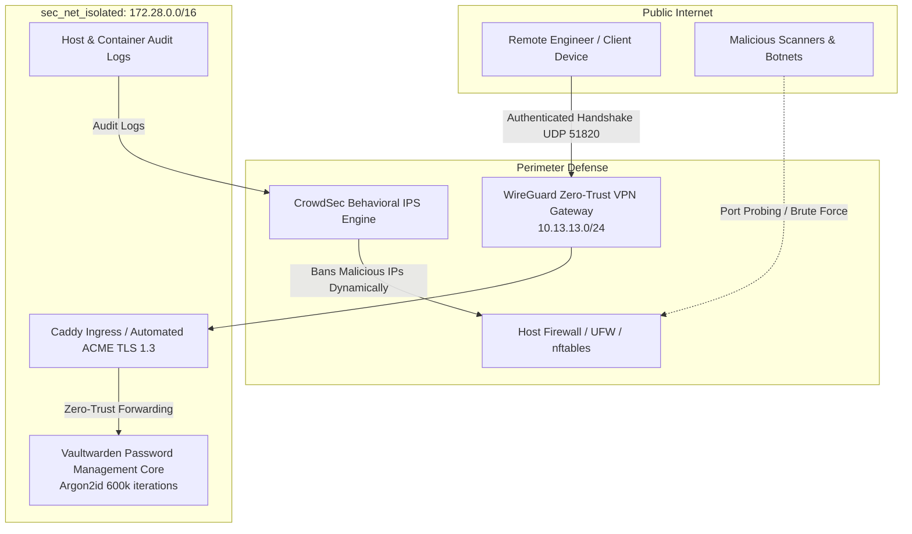

# :shield: Enterprise Zero-Trust Self-Hosted Security Suite

[](docker-compose.yml)
[](https://crowdsec.net)
[](https://www.wireguard.com)
[](https://github.com/dani-garcia/vaultwarden)
[](config/caddy/Caddyfile)

An enterprise-grade, defense-in-depth security infrastructure designed for production bare-metal and private cloud deployments. Eliminates open public exposure via an isolated **Zero-Trust WireGuard VPN overlay**, provides autonomous behavior-based intrusion prevention with **CrowdSec IPS**, and enforces hardware-accelerated **Argon2id credential isolation** via Vaultwarden.

---

## :triangular_ruler: Architectural Blueprint



---

## :key: Key Security Pillars

### 1. Zero Public Attack Surface (WireGuard Tunneling)
- **Eliminated Public Exposure**: Core administrative interfaces (Vaultwarden, monitoring, infrastructure dashboards) have zero public ports exposed to the Internet.
- **Access Control**: All connections require an active WireGuard cryptographic peer handshake on isolated subnet `10.13.13.0/24`.
- **Forward Secrecy**: Constant 256-bit ChaCha20-Poly1305 symmetric encryption with automated Curve25519 key exchanges.

### 2. Behavioral Intrusion Prevention (CrowdSec IPS)
- **Log Parsing**: Continuously streams and parses auth logs from `/var/log/auth.log`, Caddy access logs, and WireGuard handshakes.
- **Community Intelligence**: Integrates with the global CrowdSec consensus network, preemptively blocking distributed botnets, scanning agents, and credential stuffers before they touch applications.
- **Firewall Bouncer**: Dynamically pushes IP drop rules into the Linux kernel packet filter (`nftables`).

### 3. Hardened Credential Storage (Vaultwarden)
- **Argon2id Key Derivation**: Configured with `PASSWORD_ITERATIONS=600000` to prevent brute-force attacks against master keys.
- **Signups Disabled**: Strict admin authorization prevents unauthorized user registrations.
- **Burst Rate Limiting**: Maximum 5 login attempts per 60 seconds with exponential backoff on repeated failures.

---

## :rocket: Quick Start Deployment

### 1. Prerequisites
- Docker Engine 24.0+ and Docker Compose v2.20+
- Linux kernel 5.10+ with WireGuard module support (`modprobe wireguard`)

### 2. Clone and Initialize
```bash
git clone https://github.com/Aryan-136/self-hosted-security-services.git
cd self-hosted-security-services

# Create secure directories
mkdir -p config/caddy config/crowdsec scripts
chmod +x scripts/*.sh

# Boot the zero-trust stack
docker compose up -d
```

### 3. Verify System Health
```bash
./scripts/audit-security.sh
```

---

## :file_folder: Repository Layout
```text
.
├── config/
│   ├── caddy/
│   │   └── Caddyfile             # TLS 1.3, HTTP/3, and HSTS ingress configuration
│   └── crowdsec/
│       └── acquis.yaml           # Log acquisition streams for IPS engine
├── scripts/
│   └── audit-security.sh         # Automated Zero-Trust health verification
├── docker-compose.yml            # Multi-service orchestrated stack
└── README.md                     # Engineering blueprint & threat model
```

---

## :lock: Compliance & Standards
- **CIS Benchmark Aligned**: Follows Center for Internet Security Docker & Linux Host benchmarks.
- **OWASP Top 10 Protected**: Rate-limited endpoints, CSRF tokens, strict TLS ciphers, and Content-Security-Policy (CSP) headers.
